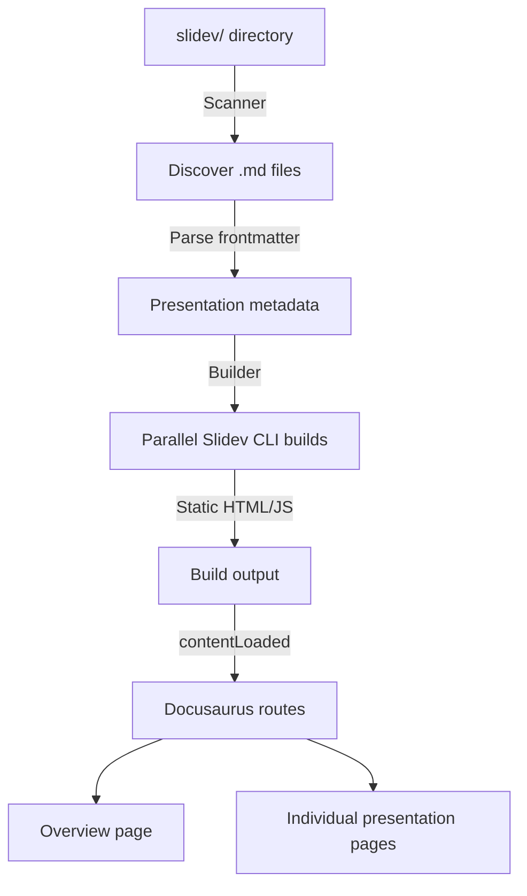

# 🦕 Introduction

**slidesaurus** bridges two powerful tools — [Docusaurus](https://docusaurus.io) for documentation and [Slidev](https://sli.dev) for presentations — letting you manage both from a single site.

## What Does It Do?

The plugin automatically discovers Slidev Markdown presentations in your project, builds them alongside your Docusaurus site, and serves them as fully navigable pages with an overview dashboard.

Instead of maintaining a separate repository or deployment for your slide decks, you co-locate them with your docs and ship everything together.

## Key Features

| Feature | Description |
|---|---|
| **Auto-Discovery** | Drop `.md` files into a `slidev/` directory and they are picked up automatically — no per-file registration required. |
| **Parallel Builds** | Presentations are compiled concurrently during `docusaurus build`, with a configurable concurrency limit and a SHA-256 incremental cache. See [Parallel Builds](./parallel-builds.md). |
| **[Theme & Addon Support](./themes-addons.md)** | Set a default Slidev theme globally or override it per-presentation via frontmatter. |
| **Zero-Config Start** | A single plugin entry in your Docusaurus config is all you need to get started. |
| **[Embeddable Previews](./slidev-link.md)** | Use `<SlidevLink>` to embed a scaled-down preview of any presentation inside any MDX page. |
| **[Categories](./categories.md)** | Organize presentations into groups using subdirectories and `_category_.yml` files. |
| **[Playlists](./playlists.md)** | Define ordered sequences of presentations for sequential navigation. |
| **[UI Themes](./custom-styling.md)** | Switch between `default`, `compact`, and `minimal` layouts — or write a fully custom CSS theme — via the `uiTheme` option. |

## Architecture

1. The **Scanner** walks the configured directory, finds all Markdown files, and reads `_category_.yml` files for grouping.
2. The **Builder** invokes the Slidev CLI for each presentation in parallel, respecting the `maxParallelBuilds` limit.
3. During the Docusaurus `contentLoaded` lifecycle, routes are registered for an overview page and one page per presentation.
4. The **theme components** render the overview grid/list and embed presentations in iframes.

## Glossary

| Term | Meaning |
|---|---|
| **Presentation** | A Slidev Markdown file (`*.md`) that defines a sequence of slides. |
| **Slide** | A single page within a presentation, separated from adjacent slides by a `---` line. |
| **Overview page** | The auto-generated browsable index of all presentations, served at `routeBasePath`. |
| **Category** | A logical group of presentations defined by a subdirectory + `_category_.yml` file. |
| **Playlist** | An ordered sequence of presentations navigable in sequence, defined via frontmatter. |
| **uiTheme** | The visual layout variant of the plugin's UI components (`default`, `compact`, `minimal`, or a custom string). |

---

## Who Is It For?

- **Developer advocates** who publish docs and conference talks from the same site.
- **Teams** that want an internal training portal alongside product documentation.
- **Open-source projects** that ship tutorials as slide decks next to their API reference.

## Next Steps

- [Installation](./installation.md) — add the plugin to your project.
- [Quick Start](./quick-start.md) — create your first presentation in 5 minutes.
- [Configuration](./options.md) — explore every available option.
- [CLI Reference](./cli.md) — scaffold, list, diagnose, and manage cache from the terminal.
